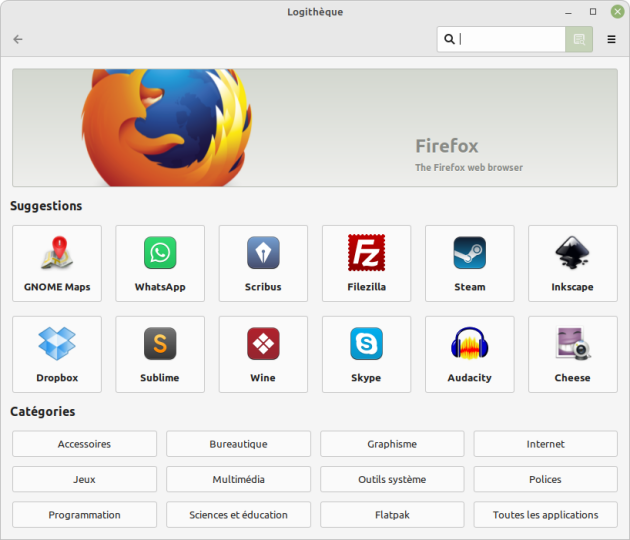

## Farewell Windows

From its initial release in 1985, I always found [Microsoft Windows](w:Microsoft_Windows) bloated and ugly. Back then, I worked summers at a computer shop selling Apple [Macintoshes](w:Macintosh) and later Commodore [Amigas](w:Amiga), and Windows looked clunky and hideous by comparison.

Above all, in Switzerland we had the [Smaky 100](https://www.smaky.ch/chapitre-4-smaky-100/) featuring a multitasking OS and overlapping windowed GUI. Windows was bloated, ugly, and backward to boot.

Over the decades, Windows kept expanding as it copied features from others, becoming resource-hungry in attempts to look modern, and more recently turning intrusive by forcing bloated default tools like Internet Explorer, then Edge, and now the Copilot AI assistant.

Worst of all, it became unstable and unreliable. Returning from a trip, after a major mandatory update, my "old" desktop PC refused to boot. I managed to resolve it by tweaking `BypassSecureBootCheck` and `BypassTPMCheck` in the registry, but what everyday user knows how to do that? And for how long will those workarounds hold?

## Hello Linux (Mint)

The silver lining of this breakdown was justifying the purchase of a new PC a year ago: an Asus TUF Gaming A15 laptop. It was the last one in the store, a display model offered with a discount. The salesman told me to come back the next day because he needed to reinstall a clean copy of Windows. I told him not to bother: I'd take it as-is because I was going to wipe it and install Linux immediately. He beamed at me, said "Welcome to the club!" and knocked an extra discount off the price!

I had dabbled with Linux twenty years ago to set up a server for my young startup on my only dual-processor rig, which Windows 2000 couldn't properly utilize. Buying Windows NT Server would have cost an astronomical sum, so I chose Linux (Ubuntu, I think), spent a few days wrestling to configure Samba shares, email services, and user permissions—and then a fire destroyed the premises...

So I felt some trepidation when installing [Linux Mint](w:Linux_Mint), a distribution chosen specifically for its desktop interface resemblance to Windows, because after 40 years, old habits die hard...

And it went smoothly like a charm. For over a year now, I've used exclusively Linux and open-source software, with zero issues and zero regrets. So much so that I wiped the Windows partition off the laptop entirely, and also installed Mint on my "old" desktop, keeping only a small fallback Windows partition "just in case."

### The Software

Like many Linux distributions, Mint comes preloaded with the essentials: web browsers ([Firefox](w:Firefox)), email clients ([Thunderbird](w:Mozilla_Thunderbird)), and office suites ([LibreOffice](w:LibreOffice)), but above all the Software Manager—a streamlined graphical tool to discover, install, and remove applications.

### Even Games Work! (Wine, Proton, Steam...)

The primary reason I hadn't touched Linux for 20 years was gaming. As a hardcore gamer, I absolutely needed a system capable of running the latest titles, and Linux simply wasn't up to the task—or at least not without endless tinkering.

Then came [Wine](w:Wine_(software)), which originally stood for "WINdows Emulator" and now backronyms to "Wine Is Not an Emulator," as it acts as a compatibility translation layer allowing Windows executables to run natively on Linux. Even the venerable [wpanorama](http://www.wpanorama.com/wpanorama.php) written in Delphi years ago runs flawlessly:



And above all, there is [Steam](w:Steam_(service)) with [Proton](w:Proton_(software)) (the gaming compatibility layer, not the Swiss encrypted services provider I'll discuss in another post). With Proton, virtually all PC games on Steam run on Linux, including GPU-heavy gems like the marvelous [Dyson Sphere Program](w:Dyson_Sphere_Program) (more on that later...).
