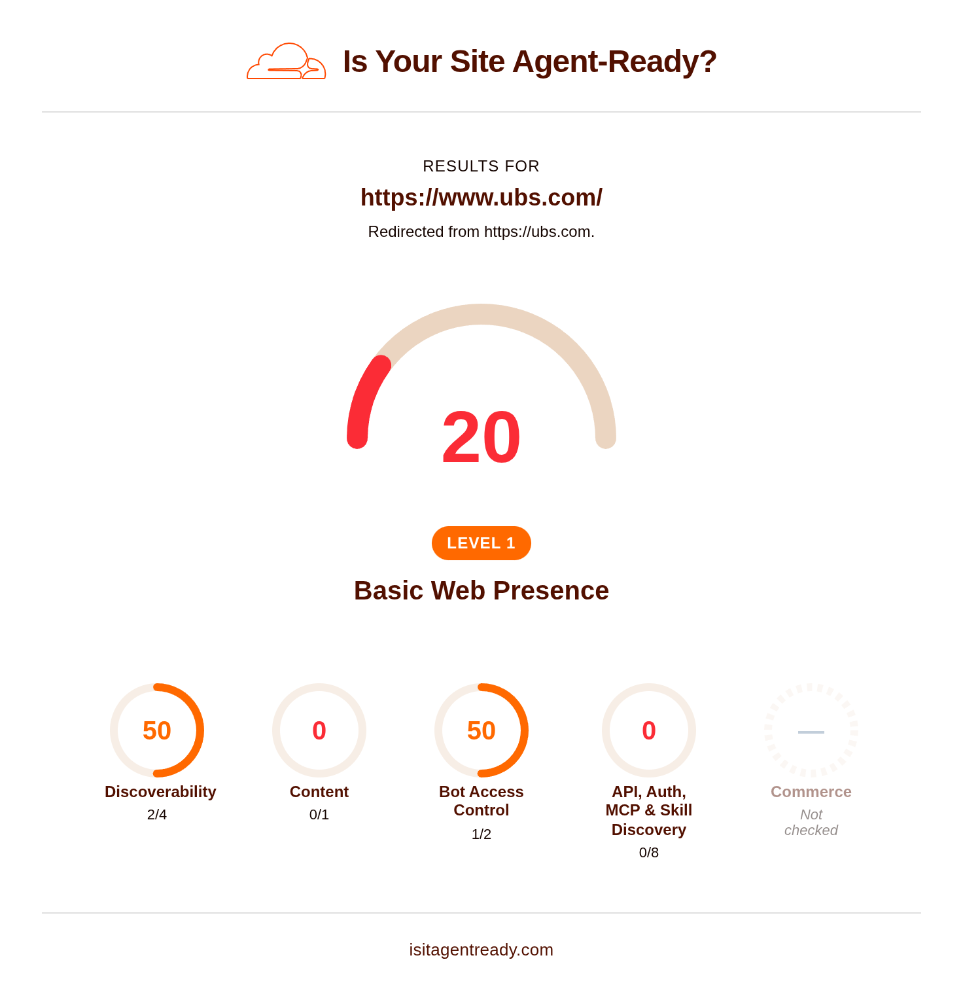
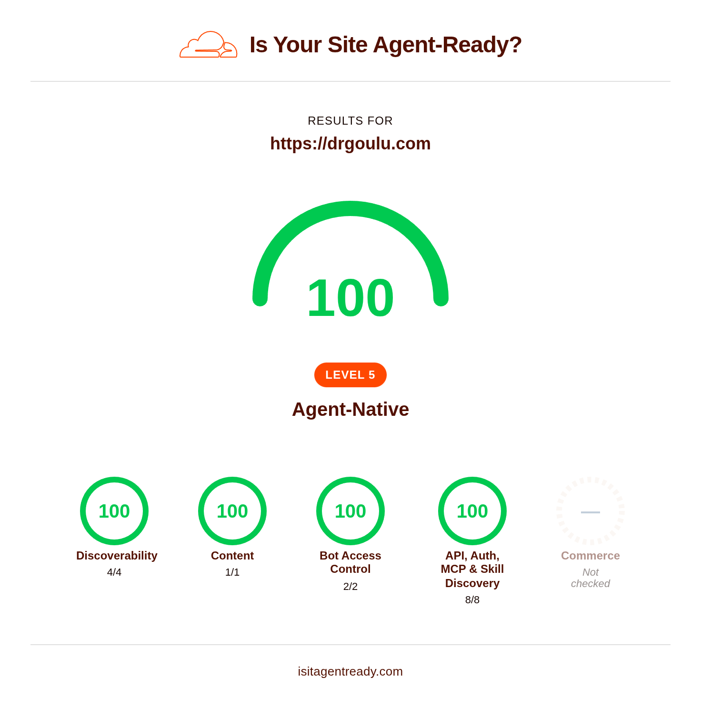

On the old drgoulu.com, I used Google Analytics to monitor site traffic. I could have continued with them, but:

1. I am in the middle of a deGAFAMisation process.
2. For some time, I had been intrigued by this little widget:



[Cloudflare](w:Cloudflare) is primarily known for its security features, but upon investigating, I saw they offer traffic analytics comparable to Google Analytics, plus a great deal more—even on a free tier.

Among other things, they built [isitagentready.com](https://isitagentready.com/drgoulu.com), a tool that scans your website to check if AI agents can read it, or even leverage the site's API to perform actions...

Initially, drgoulu.com was as locked down as a Swiss private bank:

[](https://isitagentready.com/ubs.com)

*(I forgot to take a screenshot of the initial state, but it looked just like this).*

## Room for Improvement

Above all, I wanted search engine AIs to easily discover my content, since AI-powered search is increasingly supplanting traditional keyword queries.

To achieve that, one key element is required:

### Markdown Negotiation

AIs speak [Markdown](w:Markdown). It's the native format of their text outputs, their input prompts, and virtually everything they digest effortlessly. Not HTML, which is often messy and unstructured. Markdown or nothing.

So for most sites, you need something that converts a page's HTML into Markdown for AI consumers. On WordPress, plugins like [LLM Markdown](https://wordpress.org/plugins/llm-markdown/) handle this. Alternatively, Cloudflare provides a [Markdown for agents](https://developers.cloudflare.com/fundamentals/reference/markdown-for-agents/) feature that does this for any site, but it requires a paid plan...

However, having [migrated to Hugo](/2026/08/24/migration/), my content is already written in Markdown! The only nuance is that it doesn't live on drgoulu.com directly, but [on GitHub](https://github.com/drgoulu/drgoulu.com)...

"All it takes" is telling Cloudflare to fetch the matching Markdown file from GitHub whenever an agent requests a page on drgoulu.com. This is achieved via a Cloudflare "Worker"—a lightweight piece of code executed at the edge on relevant requests. And voilà! It's completely free and runs in under a single millisecond (!!!) per request:


### robots.txt (with Content-Signal)

I believe Google originally introduced this decades ago. `robots.txt` is the standard little file found on every website telling search crawlers what they may index.

Mine now contains:


User-agent: *
Disallow: /admin/
Content-Signal: ai-train=yes, search=yes, ai-input=yes
Sitemap: https://drgoulu.com/sitemap.xml


With the rise of AI agents and guided by [isitagentready](https://isitagentready.com/drgoulu.com), I added the following directive:

`Content-Signal: ai-train=yes, search=yes, ai-input=yes`

This informs well-behaved AIs [what they are allowed to do](https://contentsignals.org) with the site's content.

I hesitated briefly over `ai-train`, which permits AIs to train on the site's articles. But considering my content is published under a [Creative Commons](/2013/01/26/acanthapis-petax-cc-et-wikipedia/) [CC-BY-NC-SA](http://creativecommons.org/licenses/by-nc-sa/3.0/ch/deed.en) license, as long as an AI occasionally cites me as a source, it's welcome to learn from my posts just as human readers do ;-)

At this stage, things were already shaping up nicely:



### API, Auth, MCP & Skill Discovery

At first glance, I didn't see much point in explaining to AIs that they couldn't do much beyond reading my site to learn things. But while I was at it, I added:

- [/.well-known/api-catalog](https://drgoulu.com/.well-known/api-catalog) stating that drgoulu.com has no public API
- [/.well-known/openid-configuration](https://drgoulu.com/.well-known/openid-configuration) specifying how a user might authenticate (which is not enabled)
- [/.well-known/oauth-protected-resource](https://drgoulu.com/.well-known/oauth-protected-resource)
- All of this summarized in [/auth.md](https://drgoulu.com/auth.md) in Markdown for AIs, preventing them from behaving like aggressive scrapers probing the site
- [/.well-known/mcp/server-card.json](https://drgoulu.com/.well-known/mcp/server-card.json)—what better than [another AI to describe its role](https://share.google/aimode/zZ6LW4PMe9kDEKAPU)?
- [/.well-known/agent-skills/index.json](https://drgoulu.com/.well-known/agent-skills/index.json), [.well-known/agent-skills/mcp-tools/SKILL.md](https://drgoulu.com/.well-known/agent-skills/mcp-tools/SKILL.md) and [.well-known/agent-skills/search-articles/SKILL.md](https://drgoulu.com/.well-known/agent-skills/search-articles/SKILL.md)

#### And Then I Was Blown Away!

In my narrow human perspective, I always thought drgoulu.com's sole purpose was publishing my articles. I saw no interactive utility whatsoever (aside from comments, which are offloaded to Disqus).

I had forgotten about the search engine!

That humble magnifying glass at the top of the page lets visitors search drgoulu.com articles in an instant thanks to a precomputed index. Why shouldn't an AI query it rather than re-indexing everything on its side? Especially when a clever technical trick allows it to receive the search results directly in Markdown!

````plain
For any article URL on `drgoulu.com`, 
request the page with an `Accept: text/markdown` header 
to receive the raw markdown content directly:
````

```http
GET /2026/09/slug/ HTTP/1.1
Host: drgoulu.com
Accept: text/markdown
```

### WebMCP and ARD (Agentic Resource Discovery)

[WebMCP](https://webmachinelearning.github.io/webmcp/) is an emerging standard designed to expose JavaScript tools to AI agents. In practice, [webmcp.html](https://github.com/drgoulu/drgoulu.com/blob/main/layouts/_partials/hooks/head-end/webmcp.html) is injected into every page of drgoulu.com to provide programmatic access to the site's internal search. To be honest, I'm not a huge fan—it slightly inflates the HTML payload and the immediate benefit remains marginal for now.

On the other hand, ARD is implemented via a simple [.well-known/ai-catalog.json](https://drgoulu.com/.well-known/ai-catalog.json) file that neatly summarizes everything above in an alternative format.

I learned a tremendous amount along the way, though my impression is that this space is still a sprawling wild west of emerging standards bound to evolve further.

Still...

## Never Without AI!

Truthfully, I would never have embarked on this journey without AI, especially the one built into Cloudflare, which is remarkable. There are so many knobs to configure in DNS settings, in the site's `.htaccess`, and so many snippets of edge code that must interact securely without opening loopholes, that even an experienced human sysadmin without AI would have taken far longer than I did with it.

In particular, a nasty infinite redirect loop arose during path resolution of [https://drgoulu.com/auth.md](https://drgoulu.com/auth.md) inside the worker; I have no idea how I would have unraveled that in under three hours alone. With a specialized AI, it still took about 10 minutes to locate and patch the bug...

What feels truly extraordinary is modern AIs' ability to craft prompts for other AIs. In essence, Cloudflare's AI would tell me:

> Copy-paste this into Infomaniak's AI assistant, then come back here and click "Continue"

Followed by:

> Copy-paste this into your IDE's coding assistant, then come back for the test run

And so on. Here is an example of such a prompt:


Implement Link Response Headers
Add Link response headers to your homepage for agent discovery per
RFC 8288 and
RFC 9727 Section 3.
Requirements
Return `Link` headers on your homepage response pointing to machine-readable resources
Use registered relation types: `api-catalog`, `service-desc`, `service-doc`, `describedby`
Example: `Link: </.well-known/api-catalog>; rel="api-catalog"`
Multiple Link headers or comma-separated values are both valid
Cloudflare
Use Transform Rules or
Workers to add Link headers
without modifying your origin server.
Validate
```
POST https://isitagentready.com/api/scan
Content-Type: application/json
{"url": "https://drgoulu.com"}
```
Check that `checks.discoverability.linkHeaders.status` is `"pass"`.


Ultimately, the results speak for themselves: drgoulu.com is now:

## 100% Level 5 Agent-Native

Here is the verdict on [https://isitagentready.com/drgoulu.com](https://isitagentready.com/drgoulu.com):



drgoulu.com is ready for the [technological singularity](w:Technological_singularity), as confirmed by the AI:

> drgoulu.com now validates the full **Auth.md + OAuth / OIDC Discovery + Protected Resource Metadata** chain at the highest level of compliance (**Level 5 Agent-Native**)!
