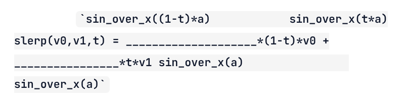
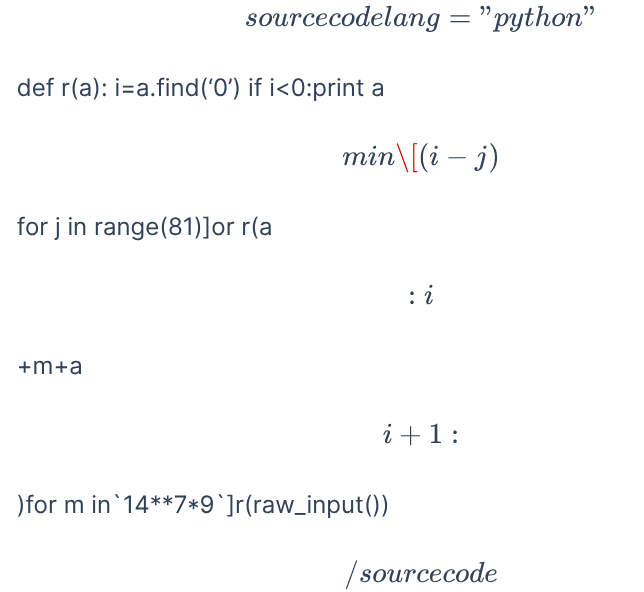

After several years of near-abandonment, I decided to revive this site for several reasons:

1. It was falling apart and that was a pity.
2. I want to transfer a significant portion of the massive content I published [on Quora](https://fr.quora.com/profile/Dr-Goulu) over recent years.
3. I have time to spare, and AIs to help me. Both proved indispensable.

## The Issues with WordPress

Since 2010, this blog was powered by WordPress, which gradually turned into a monster—largely due to the multitude of plugins I was using. It became increasingly difficult to manage versions, plugin conflicts, updates, and security vulnerabilities, not to mention bugs in certain plugins that caused the loss of numerous images.

Yet given the magnitude of the task, I was quite reluctant to change solutions. I started by cloning the site locally using [LocalWP](https://localwp.com/), which allowed me to explore files directly without relying on FTP, and crucially, without risking damage to the production site. This allowed me to update several essential plugins, notably:

* [OpenBook](https://github.com/goulu/openbook), which was accepted as an [official plugin](https://wordpress.org/plugins/openbook-book-data/) (even though the banner claims it is outdated...)
* [Reference 2 Wiki](https://github.com/goulu/reference-2-wiki) to manage the thousands of Wikipedia links across drgoulu.com
* [Altmetric](https://github.com/goulu/Altmetric), which had been abandoned
* And the [Customizr](https://github.com/goulu/customizr) theme, which appears abandoned too since my Pull Requests making it compatible with the latest WP versions have been ignored...

Even with all of that, I was still dissatisfied and driven by curiosity: how should one build a modern blog in 2026?

## "Static" Sites

The current trend is clearly leaning toward [static site generators](w:Static_site_generator): the website is treated like a software project "compiled" into static HTML pages, "just like in the old days." No more databases, no more PHP, no more potential security holes, and navigation becomes blazing fast, as you can see browsing this site...

### The Choice: Hugo

I quickly came across [Hugo](https://gohugo.io/), but out of thoroughness I also tried [Quarto](https://quarto.org/), which tempted me with its scientific focus based on Python, Jupyter, etc., though it is mostly used in academia rather than generalist blogs like mine.

I also looked at [Astro](https://astro.build), whose tech stack looks even more modern—perhaps too much so...

After asking an AI for a [comparison table](https://share.google/aimode/XGNJvQjEpjzur8hLx), I picked Hugo in its [HugoBlox](https://hugoblox.com) flavor, both comprehensive and easy to get started with.

### The Tools: Git(Hub), VSCode, ...

To set up a site, you simply run in a shell:


# Requires Node.js
npm install -g hugoblox
hugoblox create site


Fill in the fields, and you get a project folder with everything needed.

That's it.

All that's left is writing articles in [Markdown](w:Markdown), a rich-text format once confined to simple readme.md files that has become wildly popular with AI.

At that point, it becomes very natural to version all site modifications in a Git repository to ensure you [NEVER LOSE ANYTHING AGAIN](/2012/10/31/la-penible-mort-des-donnees/).

A site can also easily be [built and published automatically on GitHub Pages](https://gohugo.io/host-and-deploy/host-on-github-pages/) on every push to GitHub, but for drgoulu.com, I wanted to keep it with my web host (Infomaniak). So I configured a GitHub Action that builds the site and syncs the generated `/public` folder with Infomaniak via [rsync](w:Rsync) over SSH. It takes about 6 minutes, which is slow but acceptable when publishing an article...

### Markdown

Markdown is the major drawback of static site generators, and probably what still limits Hugo and its peers compared to WordPress: it is not [WYSIWYG](w:WYSIWYG). Even though [its syntax](https://www.markdownguide.org) makes text more visually intuitive than raw HTML, you don't see the final output.

The standard approach is to use VSCode extensions that run a local server and display live previews of the edited page upon saving:

* [Hugo IntelliSense](https://web.archive.org/web/20260826194847/https://marketplace.visualstudio.com/items?itemName=hugoblox.hugo), brand new and not very convincing yet
* [Ownable](https://ownable.dev), currently more mature in my opinion, but not perfect yet.

Otherwise, options like [Cloudcannon](https://cloudcannon.com) exist—an online Hugo editor and site manager integrated via GitHub, which I am using to write these lines because it is free for 20 days, but quite expensive afterwards, so I won't keep it, alas. Furthermore, its rendering is somewhat intermediate, with some elements appearing WYSIWYG and others not.

### Shortcodes

The difficulty stems from "shortcodes," which extend Markdown to render formatted code, YouTube videos, and so on.

Hugo [supports quite a few by default](https://gohugo.io/shortcodes/) and makes it easy to define custom ones by [writing a simple template file](https://gohugo.io/templates/shortcode/). I did this in particular for:

- [openbook4hugo](https://github.com/drgoulu/openbook4hugo), a straightforward port of the [openbook data plugin](https://github.com/goulu/openbook) for WordPress that I had spent effort maintaining because it was so essential, used across dozens of articles to show book references and covers
- [altmetric4hugo](https://github.com/drgoulu/altmetric4hugo), a port of the [Altmetric WordPress Plugin](https://github.com/goulu/Altmetric) that enriches scientific paper references

Yet with all of this, getting a true "WYSIWYG" preview without running a Hugo build remains impossible...

### Sveltia

Looking for a solution to this, I came across [sveltia-cms](https://github.com/sveltia/sveltia-cms). As its name implies, the ambition of this open-source project is to provide a complete content management system, but its Markdown editor seemed close to what I needed.

The small wrapper [headless-cms](https://github.com/drgoulu/headless-cms) allows integrating Sveltia as a Hugo module and handling the interface, in particular by adding an "edit" button to articles, visible only when authenticated with write access to the GitHub project (meaning just me...).

After a few discussions with the lead author of sveltia-cms, I realized our objectives were fairly different, so I decided to maintain [my own fork of sveltia](https://github.com/drgoulu/sveltia-cms), which I enhanced notably with:

- Support for the shortcodes used across drgoulu.com
- Managing article folder structure organized by year
- Integrating internal search directly into the link creation dialog
- And above all...

#### (Near) Real-Time Preview

Admittedly, being able to edit articles directly on the website itself is somewhat at odds with the concept of a "static site," as it requires a server more sophisticated than a simple static file host.

The normal site build cycle following a commit+push to GitHub mentioned earlier is far too slow, taking around 6 minutes.

A dedicated server is therefore needed; specifically, we use Hugo's development server, which provides a simplified compilation in just 5 to 6 seconds.

I plan to deploy this on Infomaniak one of these days, but for now I only use it for local article authoring.

## THE MIGRATION

Exporting content from the old drgoulu.com went smoothly thanks to [wordpress-to-hugo-exporter](https://github.com/SchumacherFM/wordpress-to-hugo-exporter).

The problems arose afterwards, because my old site was genuinely quite damaged.

### AI = Indispensable Assistant

Frankly, without the AI (Gemini) integrated into Antigravity (the IDE I use in preference to VSCode), I would have given up.

It allowed running dozens of search-and-replace passes that would have taken hours by hand or writing regexes in a few minutes.

The most incredible moment came when I asked it to recover missing images that had disappeared because I had hotlinked them without realizing, and the original sites had of course changed or vanished. The AI thought "all by itself" to look for them on the [Internet Wayback Machine](https://web.archive.org/web/20260000000000*/drgoulu.com), which archives old versions of virtually the entire web! And it recovered them all, downloaded them into the Hugo site, and inserted them cleanly into the articles. Wow. In just a few minutes!

> in [2007-10-11-la-bonne-maniere-de-calculer-des-trucs](dans%202007-10-11-la-bonne-maniere-de-calculer-des-trucs).md, turn the two text equations on the slerp function into LaTeX, using the Wayback Machine as reference

turned this:

into this:

$$\text{slerp}(v_0, v_1, t) = \frac{\text{sin_over_x}((1-t)a)}{\text{sin_over_x}(a)} (1-t) v_0 + \frac{\text{sin_over_x}(ta)}{\text{sin_over_x}(a)} t v_1$$

and:

> reformat the content of all highlight shortcodes reproducing what is found on the Wayback Machine

turned this:

into this:


def r(a): i=a.find('0') if i<0:print a [m in[(i-j)%9*(i/9^j/9)*(i/27^j/27|i%9/3^j%9/3)or a[j]for j in range(81)]or r(a[:i]+m+a[i+1:])for m in`14**7*9`]r(raw_input())


(a bad example since the code is on a single line...)

### Disqus Comments

One aspect of drgoulu.com that I care deeply about was also made tricky by switching to Hugo: comments.

I had to return to [Disqus](https://disqus.com/). I had used this commercial service for a while, then abandoned it in favor of native WordPress comments.

I didn't hesitate long: there is no real alternative, and a good portion of the comments were already stored there, so I installed it, and wrestled with it a bit...

There was notably a technical issue I reported to Disqus support, documented in a comment below, which I will delete once resolved.

And I am still looking for a few years of WordPress comments that failed to migrate to Disqus for an unknown reason...

(Update Oct 8: Found! The exported .xml file didn't come from drgoulu.com but from drgoulu.local, my local development copy. And Disqus binds comments to the exact article URLs... A quick search/replace in the XML later, everything was back in order!)

The remaining big piece is my plan to [migrate thousands of Quora answers here... which I cover in a separate article.](/2026/09/17/migration-de-quora-a-hugo/)

## References:

- [Migration de Wordpress vers Hugo](https://www.hleroy.com/2022/09/migration-de-wordpress-vers-hugo/), the blog post from which I borrowed the header image
