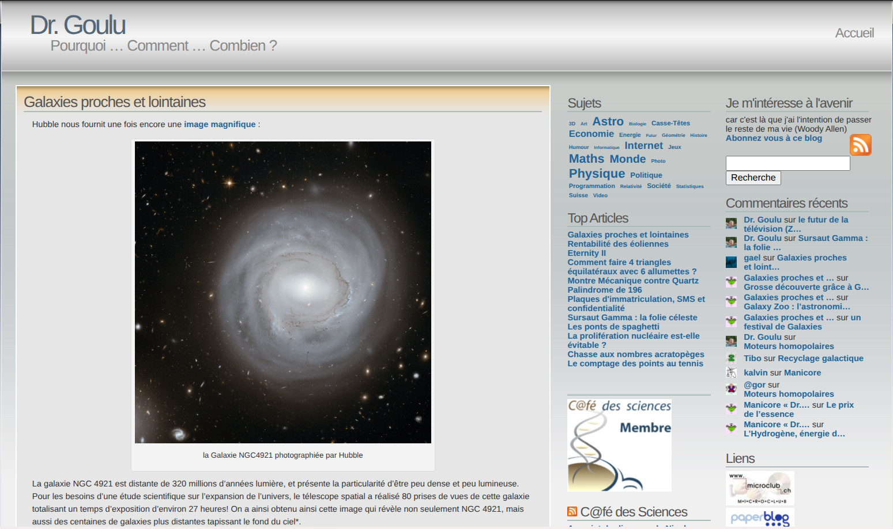

The bane of running an older website is link rot: altered pages, deleted files, recursive redirects, entire domains gone dark, or worse, taken over by shady online casinos...

Across drgoulu.com, there were over 3,500 links no longer pointing to their intended destination. On my old WordPress site, a plugin notified me of broken links every week, which was essentially useless...

And then, during the [migration from WordPress to Hugo](/2026/08/24/migration/), the AI went looking "all by itself" for missing images on the [Internet Archive](w:Internet_Archive), specifically on the [Wayback Machine](w:Wayback_Machine)—the magnificent initiative archiving historical snapshots of web pages.

For instance, searching "drgoulu.com" on [https://web.archive.org](https://web.archive.org) lets you revisit:

And that sparked my brilliant idea\* to use it to repair broken links across the entire site!

## archive_broken_links.py

A quick bout of vibe coding later, I had a [script archive_broken_links.py](https://github.com/drgoulu/drgoulu.com/blob/main/scripts/archive_broken_links.py) that crawls every link on the site, updates redirects, and fetches historical snapshots at the appropriate date if the link is broken.

Fifteen minutes later, it hadn't resolved everything, but a very substantial chunk:


Articles analyzed        : 18255
Articles modified        : 1895
Links replaced           : 3252
    - Confirmed earlier snapshots : 1335
    - No prior capture found      : 2045


Here again, it was feasible without AI, and perhaps under WordPress, but vastly, vastly more complicated.

## donotlink.it

The Wayback Machine now serves another handy purpose on drgoulu.com: linking to sites I don't wish to endorse with SEO link juice.

To illustrate certain posts on pseudoscience, I wanted to provide links without allowing the targeted websites to benefit from my backlink to boost their Google ranking. I used to rely on [donotlink.it](https://web.archive.org/web/20201101112122/https://donotlink.it/), which handled this, but the service went defunct.

Thanks to the Wayback Machine, I discovered that its [source code is on GitHub](https://github.com/connyduck/donotlink), though I have no intention of reviving a tool that is largely obsolete today.

Because the Wayback Machine achieves the exact same result! Linking to an archived snapshot confers zero PageRank benefit to the domain owner: their nonsense remains permanently recorded and accessible, without rewarding them.

And that is perhaps the gravest threat looming over the fantastic resource that is the Wayback Machine: [short-sighted individuals trying to scrub their past tracks](https://edition.cnn.com/2025/02/18/tech/internet-archives-deleted-websites-wayback-machine)...

\* Note: Did you notice? When the AI did it, I casually mentioned it as if it were routine. But when I did it, it was suddenly a "brilliant idea"...
